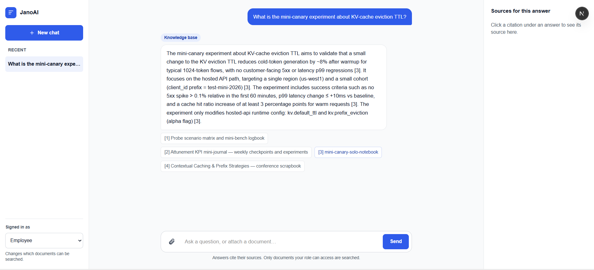
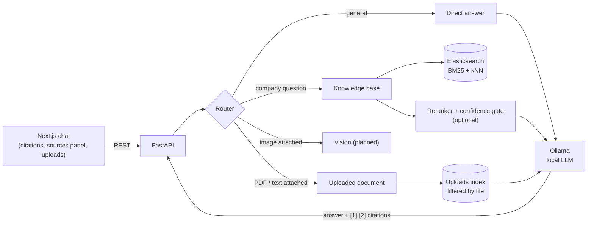

# Enterprise AI Copilot (JanoAI)

An **on-premise RAG assistant** that answers questions about company documents and uploaded PDFs, with
numbered citations and page numbers, using a **local open-weight LLM**. No data leaves the machine.

The focus is not only on building the pipeline but on **measuring it**: retrieval methods compared on a
public benchmark, a reranking cost/quality curve, failure analysis, and a study of how the model behaves
when the answer is *not* in the documents.




## Key results

On 5,000 Drive documents from [EnterpriseRAG-Bench](https://huggingface.co/datasets/SJChen02/EnterpriseRAG-Bench) (34,636 chunks, 42 questions):

| | |
|---|---|
| Hybrid search (BM25 + BGE-M3, RRF) | **93% recall@10** |
| Cross-encoder reranking of the top 10 | **recall@1 62% → 83%**, MRR 0.70 → 0.88, at 1/5 the cost of reranking 50 |
| Local Qwen3 8B, citing the right document | **97%** of answers when it was retrieved |
| Unanswerable questions: correct abstentions | **19% → 57%** with a stricter prompt + calibrated score gate, keeping 95% of answerable questions |

## Architecture



- **Retrieval:** structure-aware chunking; Elasticsearch BM25 (English analyzer) and BGE-M3 dense vectors (HNSW), fused with reciprocal rank fusion implemented in Python; optional BGE-reranker-v2-m3 cross-encoder.
- **Confidence gate:** when reranking is on, a low top score means *abstain without calling the LLM*; a medium score is flagged "low confidence" in the UI.
- **Generation:** local model through Ollama, temperature 0, a prompt that requires citations, forbids unstated conclusions, and treats document text as data, not instructions (basic prompt-injection defence).
- **Uploaded PDFs:** read page by page, chunked without crossing pages (so citations give exact page numbers), indexed in a separate index filtered by file ID: one user's upload is never searched for another's question.
- **Light mode** for small machines: BM25 only, no embedding model loaded.

## Evaluation

All numbers below come from scripts in [`eval/`](eval/); raw results are in [`eval/results/`](eval/results/).
**Caveat:** 42 questions is a small set (one question ≈ 2.4 points), and the reranking depth and gate
thresholds were chosen on the same questions, so treat those as optimistic.

### Retrieval

| Method | R@1 | R@5 | R@10 | MRR | ms/query |
|---|---|---|---|---|---|
| BM25 | 60% | 79% | 88% | 0.689 | 52 |
| Semantic (BGE-M3) | 48% | 55% | 67% | 0.534 | 66 |
| Hybrid (RRF) | 62% | 81% | 93% | 0.703 | 120 |
| Hybrid + reranker (top 50) | 76% | 93% | 93% | 0.842 | — |
| **Hybrid + reranker (top 10)** | **83%** | **93%** | **93%** | **0.882** | — |

**Keyword search beats semantic search here.** All documents describe the same fictional company, so
embeddings find the right *topic* but often the wrong *document*; BM25 matches rare exact terms
(codenames, document names).

### Reranking depth: cheaper and better

| Reranked chunks | R@1 | MRR | Paraphrased questions R@1 | CPU s/question |
|---|---|---|---|---|
| 0 (hybrid only) | 62% | 0.703 | 36% | 0 |
| 10 | **83%** | **0.882** | **71%** | 30 |
| 20 | 81% | 0.870 | 64% | 59 |
| 50 | 76% | 0.842 | 50% | 148 |

Reranking deeper lets the cross-encoder promote plausible but wrong chunks over hybrid search's good
candidates. On a laptop CPU even depth 10 is too slow for live chat, so the reranker is **off by default**
and meant for GPU or API deployment.

### Where retrieval fails

| Question type | n | Hybrid hit@10 | Hybrid MRR |
|---|---|---|---|
| Basic | 24 | 100% | 0.83 |
| Paraphrased ("semantic") | 14 | 79% | 0.46 |

Every miss is a **paraphrased question**. Example: *"the tiny production experiment that tweaks how the
model serving layer keeps and evicts attention memory"* refers to a *"mini-canary"* about *"KV-cache
eviction TTL"*: no shared keywords, and many similar documents. Chunking was not the cause: in both
analysed misses, the answer sat intact in one chunk.

### Answering, and knowing when not to

Generation with Qwen3 8B (top 4 chunks after hybrid search + reranking): the expected document was among
the sources for 93% of questions, the answer cited it in 97% of those cases, and no answer cited a
non-existent source.

To test abstention, the expected document was removed from the sources of each answerable question
(39 simulated + 3 natural "unanswerable" cases): only similar-topic documents remain.

| Prompt | Gate (abstain if reranker score below) | Answerable: answered, citing the right doc | Unanswerable: correctly abstained |
|---|---|---|---|
| v1 | none | 97% | 19% |
| v2 (stricter) | none | 100% | 26% |
| v2 | 0.6 | 95% | 57% |
| v2 | 0.75 | 90% | 76% |

**Finding:** the model answered most unanswerable questions *confidently, with valid citations, from the
wrong document* (for example, quoting another experiment's thresholds). A faithfulness metric would score
these answers highly; being faithful to the sources is not the same as being correct. Prompting alone
barely helps a small model; the retrieval-confidence gate does most of the work.

## Running it

**Requirements:** Python 3.11+, Node.js 20+, Docker Desktop, [Ollama](https://ollama.com). About 8 GB of
free memory for the full setup; light mode and a 3–4B model work in less.

```bash
# 1. Elasticsearch (localhost only, memory-capped)
docker compose -f infrastructure/docker-compose.yml up -d

# 2. A local model
ollama pull qwen3:8b                        # the evaluated model (~6 GB free memory)
ollama pull qwen3:4b-instruct-2507-q4_K_M   # or this one on a laptop: the demo model, no thinking mode

# 3. Backend
pip install -r backend/requirements.txt
cp backend/.env.example backend/.env   # choose model and light mode here
cd backend && python -m uvicorn app.main:app --port 8000   # API docs: http://localhost:8000/docs

# 4. Frontend (new terminal)
cd frontend && npm install
echo "NEXT_PUBLIC_USE_MOCK=false
NEXT_PUBLIC_API_URL=http://localhost:8000" > .env.local
npm run dev
```

The knowledge base must be built once (download, chunk, embed, index):

```bash
python benchmarks/enterprise_rag/chunk_drive.py
python benchmarks/enterprise_rag/embed_chunks.py     # ~15 min on a free Colab T4, hours on CPU
python benchmarks/enterprise_rag/index_chunks.py
```

**Tests:** `cd backend && pip install -r requirements-test.txt && python -m pytest -q` (no models or
services needed; Elasticsearch and Ollama are replaced by fakes). They also run in CI on every push.

### Configuration (`backend/.env`)

| Setting | Default | Meaning |
|---|---|---|
| `LLM_MODEL` | `qwen3:8b` | Any Ollama chat model |
| `SEMANTIC_ENABLED` | `true` | `false` = light mode: BM25 only, embedding model never loaded |
| `RERANK_ENABLED` | `false` | Cross-encoder reranking + confidence gate (use with a GPU) |
| `GATE_THRESHOLD` / `LOW_CONFIDENCE` | `0.6` / `0.85` | Abstain below / flag "low confidence" below |
| `LLM_NUM_CTX` | `6144` | Model context window; lower it to save memory |

## Project structure

```
backend/        FastAPI app: router, retrieval, PDF ingestion, generation, tests
frontend/       Next.js + TypeScript chat interface
infrastructure/ Docker Compose for Elasticsearch
benchmarks/     Dataset exploration, chunking, embedding, indexing
eval/           Retrieval, reranking, generation and abstention experiments + saved results
```

## Limitations and next steps

- Evaluated on 42 questions from one source type (Drive); thresholds tuned on the same set.
- The laptop demo runs Qwen3 4B Instruct in light mode (BM25 only), not the evaluated Qwen3 8B with hybrid
  search, so its answers are less accurate (for example, it sometimes adds small inferences the source does not state).
- Not yet: role-based document permissions (the role selector exists in the UI only), streaming
  answers, images and scanned PDFs, tables extracted as tables, query rewriting for paraphrased questions.

## Data and model licences

EnterpriseRAG-Bench (MIT). BGE-M3 and BGE-reranker-v2-m3 (BAAI), Qwen3 (Apache 2.0). Check the licence of
any other model you use: some small Qwen2.5 models use a research-only licence.
